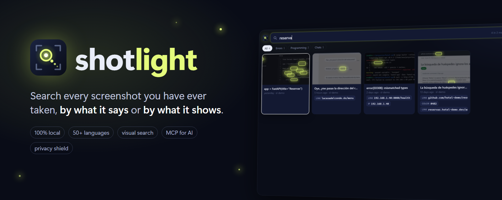
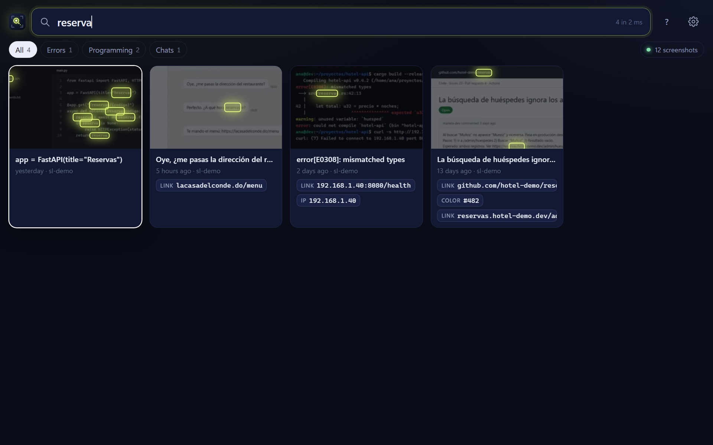
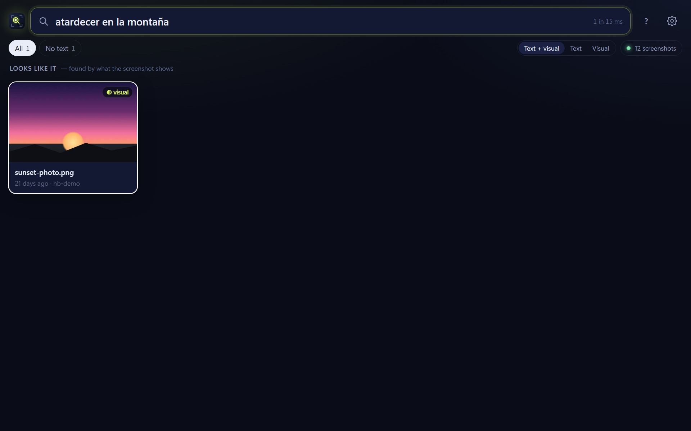
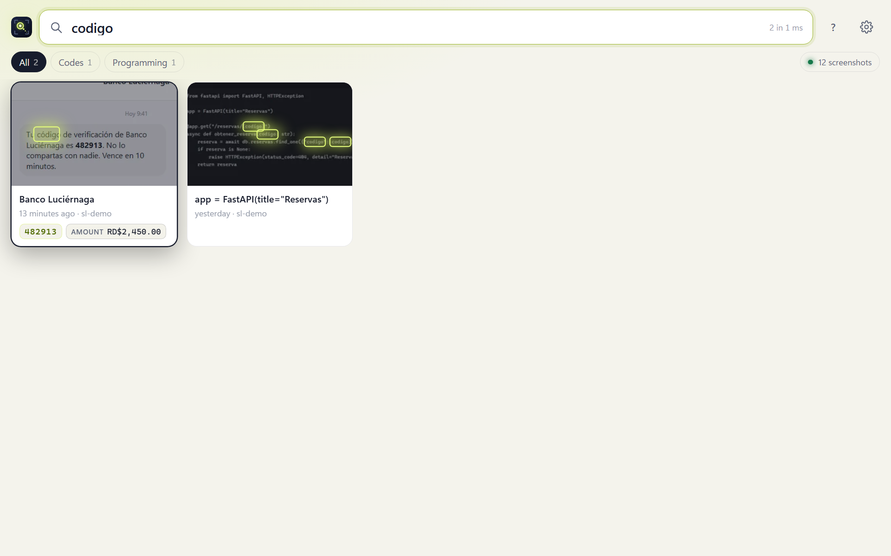

<p align="center">
  
</p>

<p align="center">
  <b>Search every screenshot you have ever taken, by what it says or by what it shows.</b><br>
  Local and private. Fifty-plus languages. Visual search. Built for people <i>and</i> their AI assistants.
</p>

<p align="center">
  <a href="https://github.com/morningstar-code/shotlight/releases/latest"></a>
  
  <a href="LICENSE"></a>
  <a href="README.es.md"></a>
</p>

Shotlight reads the text in every screenshot you take and makes all of it searchable. Press a shortcut, type a few letters of anything you remember seeing, and every matching screenshot lights up, with the matching words glowing in place. It also understands what a screenshot *shows* ("sunset", "bar chart", "a cat"), pulls out the things you usually want to copy (one-time codes, links, amounts), and keeps your secrets out of sight.

Everything runs on your computer. There is no account, no cloud and no telemetry.

<p align="center">
  
</p>

## What it does

- **Finds any word you saw.** Substring search over the text of every screenshot, as you type, in milliseconds. `nutsmp` finds `donutsmp.net`; `codigo` finds `Código`.
- **Forgives typos, yours and the OCR's.** Words one or two letters off (`invocie`, `inv0ice`, `reserba`) are found as *near matches*, always labelled and always listed after exact ones, so an error code is never silently "corrected".
- **Finds what you can't spell.** Opt-in visual search finds screenshots by what they show, in many languages: `atardecer en la montaña` finds a photo of a sunset that contains no text at all.
- **Hands you the useful bits.** One-time codes, links, emails, phone numbers, amounts, IP addresses and colors are detected and shown as chips you can copy without even opening the screenshot. `find_values otp` gives your AI the last code you received.
- **Sorts itself.** Screenshots are grouped into kinds: codes, receipts, errors, programming, chats, travel, documents. Each gets a readable title. Near-identical bursts collapse into one tile.
- **Keeps secrets secret.** API keys, tokens, card numbers and passwords are detected. Those screenshots are blurred in the grid, their values are masked, and they are never given to an AI assistant while the privacy shield is on.
- **Lets your AI search your screenshots.** A built-in [MCP](https://modelcontextprotocol.io) server lets Claude, Cursor and any MCP client search and read your screenshots, locally.
- **Reads like you do.** Text is read column by column (a sidebar is not interleaved with the page beside it), long scrolling captures are read in full-resolution tiles, and moved or renamed screenshots keep their text without being read again.
- **Lets you select text on the image.** Open a screenshot and select words right on it, or drag a box to copy just those lines.
- **Cleans up.** Suggests what is safe to throw away (old one-time codes, duplicates, screenshots with secrets) and moves it to the trash with undo.

<table>
<tr>
<td width="50%"></td>
<td width="50%"></td>
</tr>
<tr>
<td align="center"><sub>Visual search, in Spanish, finds a picture with no text at all</sub></td>
<td align="center"><sub>Accent-insensitive search; the one-time code is one click away</sub></td>
</tr>
</table>

## Download

**[Download Shotlight for Windows](https://github.com/morningstar-code/shotlight/releases/latest)** (Windows 10 and 11, 64-bit, about 126 MB, free).

1. Unzip it and move the **Shotlight** folder somewhere permanent, for example `%LOCALAPPDATA%\Programs\Shotlight`.
2. Run **Shotlight.exe**. Windows may warn about an unknown publisher, because the app is not code-signed yet: choose *More info*, then *Run anyway*.
3. Choose the folders where your screenshots are saved (Shotlight suggests the usual ones). It starts reading right away, newest first, and you can search while it reads.

Press **Alt+Shift+H** anywhere to open or close the search window. Shotlight lives in the notification area and takes no taskbar button. *Start at login* in Settings keeps new screenshots searchable in the background. Each release lists the zip's SHA-256 so you can check your download.

To update, quit Shotlight from its tray icon and replace the folder with the new one; your index and settings are kept. macOS and Linux versions are not available yet.

## Searching

| You type | You get |
|---|---|
| `invoice march` | Screenshots containing both words, on any line. Case and accents don't matter. |
| `"order confirmed"` | That exact phrase |
| `otp -whatsapp` | Leave out screenshots that mention a word |
| `in:discord` | Only screenshots in a folder whose name starts with `discord` |
| `date:week` `date:2026-10` `date:yesterday` `date:monday` `date:march` | A day, a month, a year, or the last 7 / 30 / 365 days |
| `before:2026-08` `after:2026-01-15` | Before or after a date |
| `is:otp` `is:receipt` `is:error` `is:code` `is:chat` `is:travel` `is:doc` `is:sensitive` `is:clipboard` | A kind of screenshot |
| `has:url` `has:email` `has:phone` `has:money` `has:ip` `has:color` `has:secret` | Screenshots containing a kind of value |
| `sort:old` `sort:new` | Order by date instead of best match |

Filters also work in Spanish (`en:`, `fecha:`, `antes:`, `despues:`, `tipo:`, `tiene:`), and so do their values (`fecha:ayer`, `tipo:factura`, `tiene:enlace`).

Results come in tiers: whole-word matches, then substring matches, then near matches (each newest first), then visual matches (most similar first). `sort:old` and `sort:new` order the text matches by date alone.

## Keys

| Key | Action |
|---|---|
| Type | Search |
| Arrow keys | Move between results |
| Enter | Open the selected screenshot |
| Ctrl+C | Copy its text, or the words selected on the image |
| Ctrl+Shift+C | Copy the image |
| Ctrl+O / Ctrl+Shift+O | Open in your image viewer / show in its folder |
| Space, Ctrl+Shift+A | Mark one / mark all results |
| Delete, then Ctrl+Z | Move to the trash, then undo |
| Ctrl+E | Expand groups of near-identical screenshots |
| Alt+1…9 | Switch category |
| Ctrl+, | Settings |
| Escape | Back, clear the search, then hide the window |

In an open screenshot, drag a box to copy only the lines inside it, and double-click to zoom.

## For AI assistants (MCP)

Shotlight includes an MCP server, so your assistant can answer "what was the verification code I just got?" or "find the screenshot of that error from last week and explain it".

```sh
claude mcp add shotlight -- "%LOCALAPPDATA%\Programs\Shotlight\shotlight-cli.exe" mcp
```

Use the folder where you put Shotlight. For Claude Desktop, Cursor and other clients, `shotlight-cli.exe mcp-config` prints the JSON to paste into their configuration; Settings → AI assistants shows both, ready to copy. The server offers five tools:

| Tool | What it does |
|---|---|
| `search_screenshots` | Search with the same syntax as the window; returns titles, dates, paths, matching lines and detected values |
| `get_screenshot` | The full text of one screenshot, its values and metadata, and optionally the image itself |
| `recent_screenshots` | The latest screenshots, optionally of one kind |
| `find_values` | The most recent codes, links, emails, phone numbers, amounts, IPs, colors or paths |
| `index_status` | How much is indexed and whether reading is in progress |

It reads the local index directly, so it works whether or not the app is running. While the privacy shield is on, secrets are masked in every answer and images that contain them are withheld.

## Command line

`shotlight-cli.exe`, next to `Shotlight.exe`, runs the same features from a terminal:

```sh
shotlight-cli search invoice date:month      # search (--json for scripts, --paths for file lists)
shotlight-cli search "otp -whatsapp"        # quote queries that exclude words
shotlight-cli show 42                        # everything read from one screenshot
shotlight-cli index "%USERPROFILE%\Pictures\Screenshots"   # add a folder and index it now
shotlight-cli folders add|remove|list PATH
shotlight-cli serve                          # run without a window and use it from a browser
shotlight-cli ocr image.png                  # read one image without indexing it
shotlight-cli export --format md             # all recognized text, as JSON lines, JSON or Markdown
shotlight-cli stats | doctor
```

## How it works

```
screenshot saved ─▶ reader (low priority) ─▶ PP-OCRv6 on ONNX Runtime ─▶ lines + boxes
                                           ├▶ entities, kind, title, burst, thumbnail
                                           └▶ image embedding (if visual search is on)
                                                       │
                                  SQLite: trigram FTS5 + word FTS5 + vocabulary index
                                     │                                       │
     search window (system web view) ◀── local HTTP API          CLI · MCP server (read SQLite directly)
```

- **Reading.** [PaddleOCR](https://github.com/PaddlePaddle/PaddleOCR)'s PP-OCRv6 models through [RapidOCR](https://github.com/RapidAI/RapidOCR) and ONNX Runtime, on the CPU. The default recognizer covers Chinese, Japanese and about 50 Latin-script languages with their accents. Extra scripts (Korean, Cyrillic, Arabic, Devanagari, Thai, Greek, Tamil, Telugu) re-read only the lines the default model was unsure of. A separate low-priority process does the reading, so the window never stutters, and the models are unloaded after five idle minutes.
- **Searching.** One SQLite database with three full-text indexes: trigrams for substrings, words to rank whole-word matches first, and a vocabulary index that finds words within one or two edits for near matches. Everything is stored lowercase and without accents.
- **Visual search.** [SigLIP 2](https://huggingface.co/google/siglip2-base-patch16-224) (multilingual, about 380 MB) or CLIP ViT-B/32 (English, about 150 MB), quantized ONNX, downloaded only when you switch it on. Each screenshot is embedded once in the background; a query is compared with all of them in milliseconds.
- **The window** is a plain HTML, CSS and JavaScript page served from 127.0.0.1 and shown in the system web view by [pywebview](https://pywebview.flowrl.com). The API needs a per-session token, kept in an HttpOnly, SameSite=Strict cookie, and checks the Host header, so other websites can neither read your screenshots nor act on them.


## Measured

On an Intel i9-14900KF with 64 GB of RAM, Windows 11, CPU only:

| | |
|---|---|
| Reading one 1440×900 screenshot | 0.5–0.8 s (the first one also loads the models, about 1 s) |
| Search, per keystroke | 5–15 ms on 3,000 screenshots of about 20 lines each, typo-tolerant queries included; about 1 ms on the 12-screenshot demo set |
| Visual query | about 12 ms once the model is loaded; the first one after idle returns text results immediately and visual ones a second later |
| Background reader, idle | about 40 MB |
| App without a window (`shotlight-cli serve`) | about 43 MB |
| App with its window resident (hidden, ready to summon) | about 120 MB, plus about 290 MB of WebView2 processes |
| Visual search in use | about 390 MB more while the multilingual text model is loaded; it is unloaded after 2 idle minutes |

Your numbers will differ; `shotlight-cli doctor` and `shotlight-cli stats` show yours.

## Compared with gyotaku

Shotlight is a reimagining of [gyotaku](https://github.com/xevrion/gyotaku) by [@xevrion](https://github.com/xevrion), whose idea, search window and careful engineering inspired it. No code is shared: Shotlight is an independent implementation with a different design. Several items on gyotaku's roadmap are in Shotlight today:

| | gyotaku | Shotlight |
|---|---|---|
| Text search with PP-OCR models, offline | ✅ | ✅ |
| Near matches for OCR look-alikes | ✅ | ✅, plus your own typos (edit distance) |
| Folder and date filters | ✅ | ✅, plus kinds, detected values, exclusions, phrases, sort, Spanish aliases |
| Visual search ("the one with a cat") | on the roadmap, its most requested feature | ✅ multilingual |
| Automatic titles and kinds of screenshot | on the roadmap | ✅ offline |
| More scripts (Cyrillic, Hangul, Arabic, …) | on the roadmap | ✅ eight extra recognizers |
| Clipboard-only screenshots on Windows | written, untested | ✅ |
| Copy codes, links and amounts from results | | ✅ |
| Secret detection and privacy shield | | ✅ |
| MCP server for AI assistants | | ✅ |
| Cleanup suggestions | | ✅ |
| Select text directly on the image | drag a box to copy | ✅ both |
| Interface languages | English | English, Spanish |
| Native UI, ~37 MB idle, ~120 ms summon, 144 fps | ✅ (Rust + GPUI) | ✗ a system web view: more memory |
| Installers and packages for Linux, macOS and Windows | ✅ | Windows download (zip) only, for now |

If you want the leanest native app, gyotaku is excellent. If you want visual search, AI integration and the extras above, try Shotlight.

## Privacy

Shotlight has no telemetry, accounts or update checks, and it switches off ONNX Runtime's own usage reporting on Windows. The default text-reading models come inside the RapidOCR package, so a standard install needs no download at all. Shotlight only downloads models you opt into: a recognizer for an extra script (from ModelScope, through RapidOCR) or, if you enable visual search, one image-text model from Hugging Face, pinned to a fixed version and checked against its SHA-256. Your screenshots, their text and the index never leave your computer, except what you choose to give an AI assistant through MCP. Shotlight never modifies or deletes a screenshot unless you move it to the trash yourself.

Everything Shotlight stores (index, thumbnails, settings, models) lives in one folder, `%LOCALAPPDATA%\Shotlight`. To uninstall and forget everything, turn off *Start at login* in Settings, quit Shotlight from its tray icon, and delete the Shotlight program folder and `%LOCALAPPDATA%\Shotlight` (plus the *Shotlight Clipboard* folder in your Pictures, if you used clipboard capture).

## Roadmap

- [ ] A Windows installer with automatic updates, and a code-signed app
- [ ] macOS and Linux versions
- [ ] Lower memory while the window is hidden (release the web view, recreate it on the shortcut)
- [ ] GPU reading through DirectML, CUDA and CoreML
- [ ] Group screenshots by app (window title at capture time)
- [ ] Ask questions about a screenshot with a local vision-language model
- [ ] More interface languages
- [ ] Handwriting

## Feedback

Bug reports and ideas are welcome in [issues](https://github.com/morningstar-code/shotlight/issues). Report security problems privately as described in [SECURITY.md](SECURITY.md).

## The name

**Shotlight** is a spotlight for your screenshots. They wait in the dark; type a few letters and the words you are looking for light up, like fireflies on a summer night. The logo is a magnifying glass whose handle is a firefly's trail, framed by the corners of a screen capture.

## License

Shotlight is **free to use**, for personal and commercial purposes; it is not open source. See [LICENSE](LICENSE). It is built on open-source components, listed with their licenses in [THIRD_PARTY_NOTICES.md](THIRD_PARTY_NOTICES.md). The PaddleOCR models are licensed under Apache-2.0, SigLIP 2 under Apache-2.0 and CLIP under MIT.
